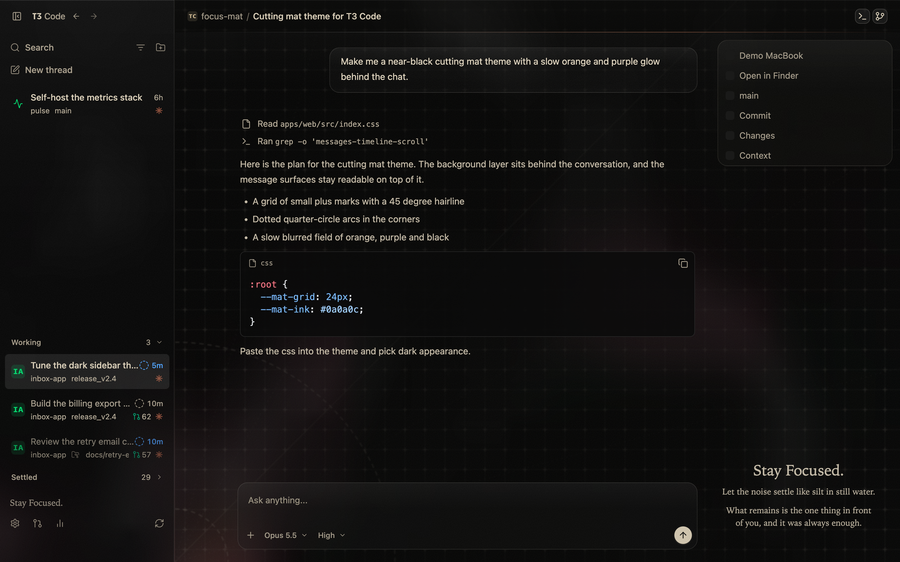
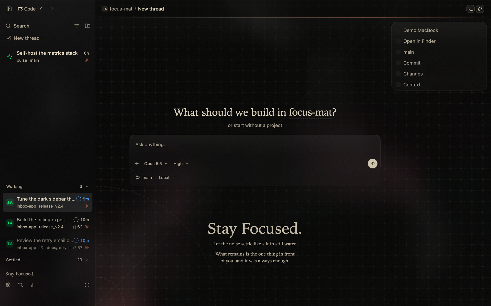
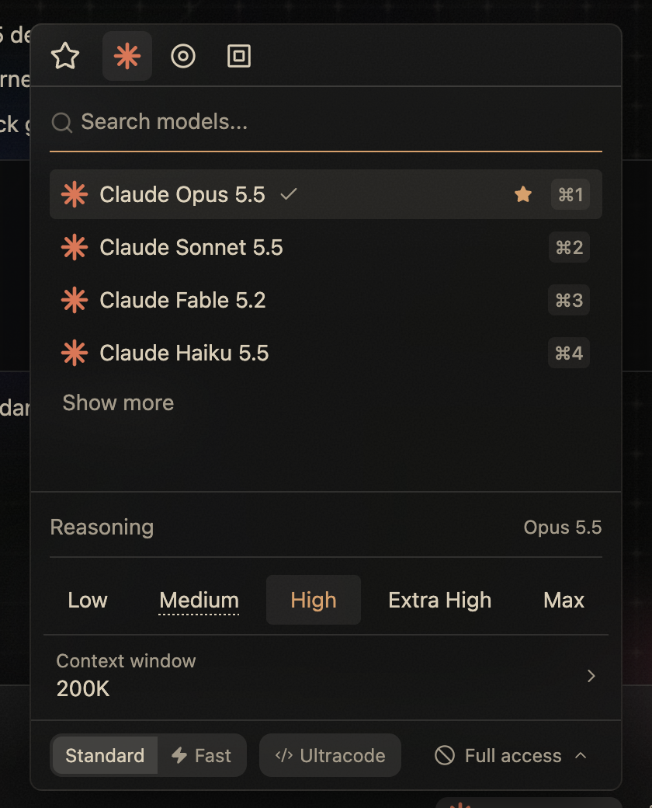
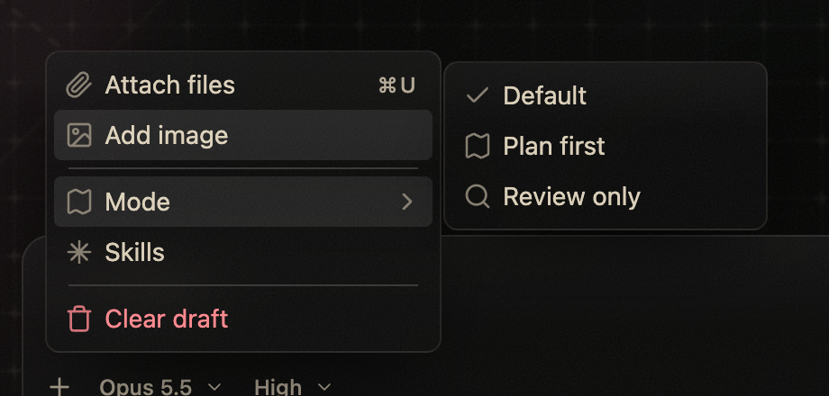

# Focus Mat

A dark cutting mat theme for T3 Code, with a slow lava lamp background and the words "Stay Focused."





One theme file. No fork and no source changes. It is built on T3 Code's own theme system and uses about 19,930 of its 20,000 characters of style rules.

## What it does

- Near black base with a slowly moving field of orange and a little purple behind a cutting mat grid
- See-through, lightly frosted sidebar, composer, message bubbles and thread details card
- Warm dim cream text and an amber accent in place of bright white and violet
- "Stay Focused." in a serif face with twenty calm quotes that change every two minutes
- Menus, popups, tooltips and dialogs in the same see-through look
- Two-line thread rows in the sidebar with a timer in place of the word "Working", and New thread on its own row under Search
- One-column model picker with the effort levels as a single bar

| Model picker | Menu |
| --- | --- |
|  |  |

## Install

1. Download [`focus-mat.json`](https://raw.githubusercontent.com/AryanRG/focus-mat/main/focus-mat.json).
2. In T3 Code, open **Settings → Appearance** and click **Add a theme**.
3. Drop the file in (or paste its contents into **Theme JSON**), then pick **Focus Mat**.

The theme is dark only.

T3 Code raised its limit on theme css from 20,000 to 50,000 characters in mid November 2026. For builds with the new limit there is [`focus-mat-full.json`](https://raw.githubusercontent.com/AryanRG/focus-mat/main/focus-mat-full.json), which carries all 36 quotes. It comes from the same generator but has not been tried in a running app yet.

## Cost

The background was built to be cheap. Each layer is one small picture holding nine frames, moved with stepped `transform` and `opacity` only, so the browser can run it without touching the page's main thread. It steps ten times a second, pauses while a dialog is open, and does not run when the system asks for reduced motion. Measured on a test page, the page does no repeated work while idle.

The quotes are one small picture that changes with a short fade every two minutes and rests in between. They are hidden when the system asks for reduced motion.

## Build it yourself

The theme file is generated.

```sh
pip install pillow
python3 src/build.py                    # writes src/theme.json and src/theme.css
cp src/theme.json focus-mat.json
FM_LIMIT=50000 python3 src/build.py     # the larger build with every quote
```

- `src/build.py` holds the colour roles and most of the style rules, regrades the background frames darker and packs them into two small sprite pictures.
- `src/frames/` holds the 17 stills the background moves through.
- `src/quotes.json` holds the quotes, and `src/quotes.py` turns them into one small animated picture. The build uses as many as fit the limit.
- `src/clawd-set.css` holds the sidebar and model picker layout rules (see credits).
- `src/surfaces.css` holds the rules for menus, popups, tooltips and dialogs.
- `src/squeeze.py` shortens the finished css without changing what it draws.

Some knobs can be set from the environment, for example `FM_PURPLE=0.5 python3 src/build.py` for less purple, `FM_WARM` for the strength of the orange, `FM_QHOLD` for how many seconds each quote stays, and `FM_QUOTES` for how many quotes to include. The check that every quote fits its slot uses a font file that ships with macOS; elsewhere it falls back to a length limit.

Older T3 Code builds limit a theme to 20,000 characters of css, and every build strips anything that loads from outside the theme, so every picture is embedded and every rule is kept short.

## Notes

- Built on T3 Code Nightly (November 2026) on macOS. The theme styles the app through its internal attributes, so an app update may break a piece. If something looks off, open an issue.
- The previews are rendered from a rebuilt test page with demo data, not from a running app.
- Unofficial. Not affiliated with or endorsed by T3, Anthropic, Wallpaper Engine or Seyul. Claude is a trademark of Anthropic.

## Credits

See [CREDITS.md](CREDITS.md). In short: the look is inspired by the [Cutting Mat](https://steamcommunity.com/sharedfiles/filedetails/?id=3818894106) wallpaper by Seyul for Wallpaper Engine, and the sidebar and model picker layout is adapted from [T3 Clawd](https://github.com/rohit3a/t3-clawd) by rohit3a.

## License

MIT. See [LICENSE](LICENSE).

MIT covers this project's own code and text. The stills in `src/frames/` (and the background pictures built from them) come from Seyul's wallpaper and are included with credit, not relicensed. Names and logos shown in `docs/` belong to their owners.
